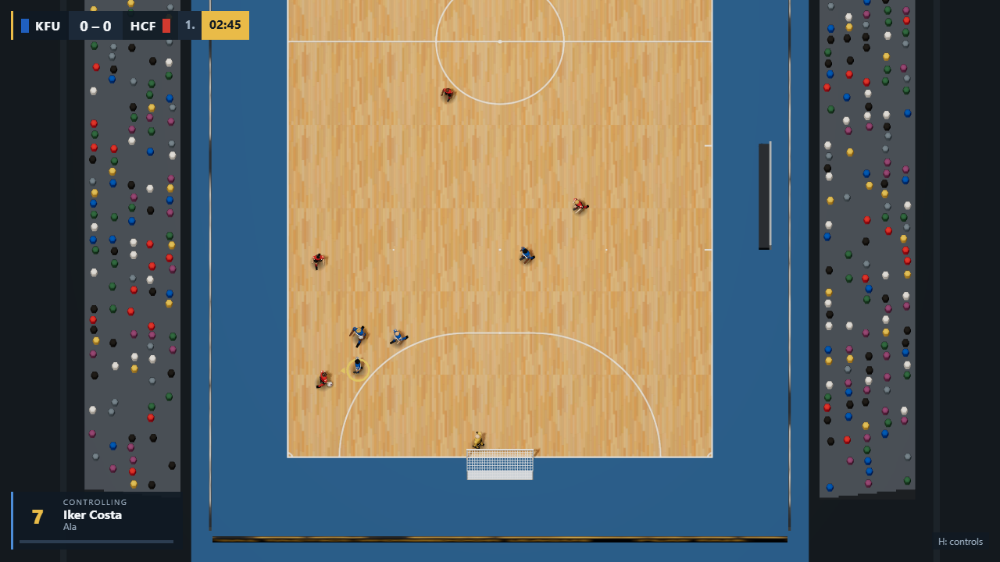
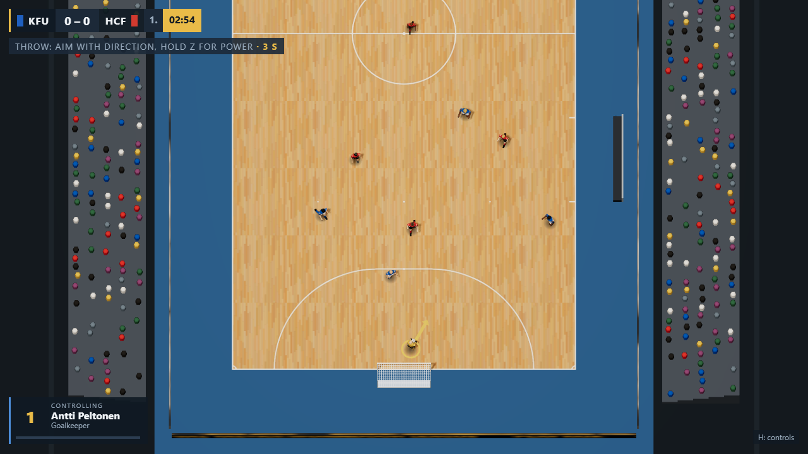
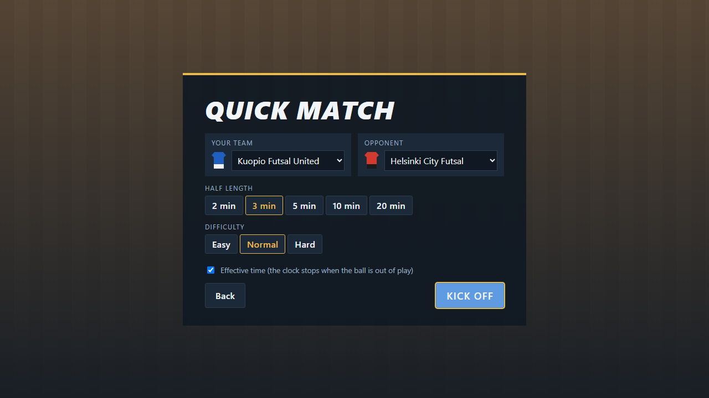
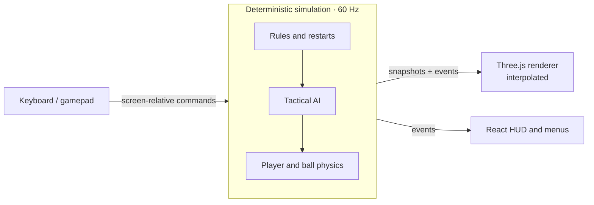

<div align="center">

# ⚽ Futsal Tactics World

**Arcade-fast controls. Real futsal tactics. Straight in your browser.**

An original 5-a-side futsal game built from scratch in TypeScript and Three.js: instant pick-up-and-play
controls on top of a deterministic match simulation with a tactical AI that defends in a diamond,
marks man-to-man and runs set-piece routines.




</div>

---

## Why it is different

- **Futsal, not small football.** 40 × 20 m court, 3 × 2 m goals, a heavy low-bouncing ball, kick-ins
  instead of throw-ins, the keeper's four-second rule, second-possession rule and the hands-vs-feet
  rule after a back pass.
- **Controls that feel immediate.** Screen-relative movement, tap-or-hold shooting, one-touch input
  buffering, assisted passing that leads the receiver — and a fully manual mode when you want it.
- **An AI that plays like a futsal team.** A compact defensive diamond that moves with the ball,
  one-to-one marking from the inside shoulder, cover defenders, counter-attack recovery, a roaming
  pivot and rehearsed kick-in and corner routines.
- **Deterministic and tested.** A 60 Hz simulation with seeded randomness runs headless; gameplay
  behaviour is measured in automated tactical tests, not just eyeballed.
- **Runs anywhere.** A static site: no server, no accounts, no paid services and no external assets.
  Everything you see — players, hall, crowd, nets — is generated procedurally.

## Features

### On the ball

|                 |                                                                                                                                                                                                                                                                            |
| --------------- | -------------------------------------------------------------------------------------------------------------------------------------------------------------------------------------------------------------------------------------------------------------------------- |
| **Passing**     | Hold the pass button for a firmer ground pass (a long press picks the teammate further away in that direction); the chip button dinks it slow and high over the opponents (a tap just over a leg, a long press up to about 5.5 m high). Assisted, semi-assisted or manual. |
| **Shooting**    | Tap for a quick, low shot placed in the near or far corner that the keeper cannot hold; hold for more pace and height — a full charge lifts the heavy ball over the bar.                                                                                                   |
| **Dribbling**   | Close control at running pace, touch-by-touch at a sprint, sole control and shielding: hold sole control and your player turns his back to the nearest opponent.                                                                                                           |
| **First touch** | A teammate takes even a firm pass cleanly; one that strikes an opponent usually bounces off him; shots that hit a defender rebound instead of sticking to him.                                                                                                             |

### Goalkeeping



- Saves end in the hands or are parried wide, away from the danger zone.
- Long-range shots are almost always stopped — unless a player screens the keeper's view.
- Holding the ball you control the keeper: walk in the area, aim with the direction keys, hold for
  power — soft throws roll along the floor, hard ones fly overarm.
- Back passes must be played with the feet, and opponents will press him.
- Four seconds too long? Indirect free kick to the opponents.

<br clear="right">

### Tactical AI

- **Defence:** high, compact diamond (pivot, two alas, fixo) that slides with the ball; every defender
  marks one opponent goal-side; a man far from the ball is marked loosely from the middle; the press is
  measured far from goal and closes the central lane.
- **Help and recovery:** when the first defender is beaten a teammate comes across; outnumbered near
  goal, the last man steps out; after losing the ball out of shape, everyone sprints back to his man.
- **Attack:** forward passes to players in scoring positions first, 1-v-1 dribbles on the wing or in
  the middle (never by the last man), circulation when nothing is on, breakaways finished low into a
  corner, support players who move away from their markers to offer a pass.
- **Set pieces:** kick-in and corner routines with a short man for a first-time shot, a pivot coming
  out from the back post and a deep man showing for a pass back.
- **Rotations:** wall pass, overlap, pivot rotation (3-1), 4-0 rotation and back-post rotation, with
  one man always kept behind the ball; formations 3-1 / 4-0 / 2-2, pressing height and pressing
  triggers.
- **Tactical Lab:** set situations (breakaway, 2 v 0, 3 v 2 counter, the rotations, build-up against a
  high press) played again and again — watch, attack or defend, change the tactics and the speed, count
  the outcomes. The AI view (key 7) shows what every computer player intends and who marks whom.

### Match and presentation

- Quick Match with clubs and men's and women's national teams (Finland included), half length (2–20
  min), effective or running clock and three difficulty levels that change the opponent's decision
  quality. Players are fictional; for private local play you can load real squads from a git-ignored
  file (see [src/data/local/README.md](src/data/local/README.md)).
- Two halves with ends switched (your team keeps attacking up the screen), full-time result screen with
  shots, possession, passes, saves, corners and kick-ins.
- Vertical 78° orthographic camera plus horizontal side views and a **Camera Lab** to tune your own
  camera live; a radar minimap; procedural players with a keyframed run cycle, goal nets that bulge,
  a ball that keeps flying into the advertising boards when it goes out.
- Finnish and English UI. Keyboard and gamepad, including menu navigation. Rebindable keys.

<p align="center">
  
</p>

## Quick start

Requires Node.js 20.19+ or 22.12+.

```bash
git clone https://github.com/janti/futsal-tactics-world.git
cd futsal-tactics-world
npm install
npm run dev          # open http://localhost:5173
```

Production build: `npm run build`, then `npm run preview`. Add `?gfx=low`, `?gfx=medium` or
`?gfx=high` (default) to the URL to pick a graphics preset.

## Controls

| Action                                               | Keyboard          | Gamepad            |
| ---------------------------------------------------- | ----------------- | ------------------ |
| Move (relative to the screen)                        | WASD / arrow keys | Left stick / D-pad |
| Pass (hold = firmer) · standing tackle               | Z (or J)          | A                  |
| Shoot — tap: placed low shot, hold: power and height | X (or K)          | B                  |
| Chip (hold = higher and longer)                      | C (or L)          | X                  |
| Switch player                                        | V (or I)          | Y                  |
| Sprint                                               | Shift             | RT                 |
| Sole control · shield · jockey                       | Space             | LT                 |
| Camera preset                                        | F5 or 5           | —                  |
| Camera Lab                                           | 6                 | —                  |
| AI view (intentions, marking, rotations; radar)      | 7                 | —                  |
| Tactical Lab: start the situation again              | R                 | —                  |
| Pause                                                | Esc or P          | Start              |
| Show controls                                        | H                 | —                  |

- **Keeper throw:** with the ball in the keeper's hands, aim with the direction keys and hold Z (or X/C)
  for power, release to throw.
- **One-touch play:** press pass or shoot just before the ball arrives.
- **Restarts** (kick-off, kick-ins, corners, free kicks) must be kicked: the taker aims by walking round
  the ball; kick-ins, corners and free kicks have a four-second limit.
- **Menus with a gamepad:** D-pad or stick moves, left/right changes a setting, A selects, B goes back.

### Settings

Available on the title screen and in the pause menu, applied immediately and remembered:

| Setting                                              | Options                                                                                                     |
| ---------------------------------------------------- | ----------------------------------------------------------------------------------------------------------- |
| Player selection when defending                      | Nearest player (automatic) · assisted · manual                                                              |
| Passing assistance                                   | Assisted · semi-assisted · manual (all with charged power)                                                  |
| Keyboard controls                                    | Rebind any game action; reset to defaults                                                                   |
| Player size                                          | 100 % (true scale) · 106 % · 112 %                                                                          |
| Camera                                               | Vertical Smart · Classic · Full Court · Close Action · Horizontal Tactical · Horizontal Full Court · Custom |
| Radar (minimap)                                      | On · off                                                                                                    |
| Graphics quality                                     | Low · medium · high                                                                                         |
| Keep my team attacking up the screen after half-time | On · off                                                                                                    |
| Language                                             | Suomi · English                                                                                             |

## How it works



- The **simulation** owns the match: typed commands in, snapshots and events out, seeded randomness.
  It has no dependency on the DOM, Three.js or React, so it runs headless in tests and the same command
  stream always reproduces the same match.
- The **renderer** interpolates between the last two snapshots and never changes the game state.
- The **AI** lives in `src/ai` in layers — team (defending, attacking, phases, roles), player
  (carrier, goalkeeper, off-ball), passing, movement and a pitch-control grid — the physics in
  `src/physics`, the rules engine in `src/simulation`.

More detail in [ARCHITECTURE.md](ARCHITECTURE.md) and [AI_DESIGN.md](AI_DESIGN.md).

## Quality

```bash
npm test             # 267 unit, integration and tactical tests (headless simulation)
npm run test:e2e     # 7 Playwright browser tests (first time: npx playwright install chromium)
npm run typecheck    # strict TypeScript
npm run lint         # Oxlint
npm run format       # Prettier
```

Tactical tests check behaviour against numbers, for example:

- the keeper saves almost every long shot with a clear view, but screened shots go in about a third
  of the time;
- breakaways are finished low into a corner and scored a little over half the time;
- in AI vs AI play about 91 % of passes arrive and the middle between ball and goal is covered about
  87 % of the time;
- difficulty levels measurably change how much the opponent dominates.

## Roadmap

| #   | Milestone                                                                             | Status  |
| --- | ------------------------------------------------------------------------------------- | ------- |
| 0   | Project foundation                                                                    | ✅ Done |
| 1   | Playable 3D prototype                                                                 | ✅ Done |
| 2   | Complete basic arcade match                                                           | ✅ Done |
| 3   | Gameplay physics and controls polish                                                  | ✅ Done |
| 4   | Camera and visual identity (all camera presets, Camera Lab, radar, graphics settings) | ✅ Done |
| 5   | Tactical AI foundation (utility AI, spatial reasoning)                                | ✅ Done |
| 6   | Advanced futsal tactics (formations, rotations, pressing triggers, Tactical Lab)      | Next    |
| 7   | Rules and tactical editor (fouls, cards, substitutions, timeouts, flying keeper)      | Planned |
| 8   | Presentation and analysis (audio, crowd, replays, statistics)                         | Planned |
| 9   | Career mode                                                                           | Planned |
| 10  | Release preparation (performance, accessibility, offline play)                        | Planned |

Details: [ROADMAP.md](ROADMAP.md) · [TASKS.md](TASKS.md) · [CHANGELOG.md](CHANGELOG.md)

## Deployment

The build is a static site with a relative base path, so `dist/` can be served from any static host
or sub-path, such as GitHub Pages:

1. `npm run build`
2. Publish the `dist/` folder (for example with a GitHub Actions Pages workflow).

No server-side code is needed.

## Documentation

| Document                            | What it covers                           |
| ----------------------------------- | ---------------------------------------- |
| [GAME_DESIGN](GAME_DESIGN.md)       | Vision, controls, game modes             |
| [ARCHITECTURE](ARCHITECTURE.md)     | Simulation, rendering, data flow         |
| [AI_DESIGN](AI_DESIGN.md)           | Team and player AI, measured behaviour   |
| [TACTICS_DESIGN](TACTICS_DESIGN.md) | Futsal tactics model                     |
| [RULES_DESIGN](RULES_DESIGN.md)     | Implemented rules and simplifications    |
| [CAMERA_DESIGN](CAMERA_DESIGN.md)   | Camera presets and screen-relative input |
| [ART_DIRECTION](ART_DIRECTION.md)   | Visual style                             |
| [ASSET_LICENSES](ASSET_LICENSES.md) | Asset sources (all procedural)           |

## Built with

TypeScript (strict) · Vite · Three.js · React · Zustand · Vitest · Playwright · Oxlint · Prettier

---

<sub>Futsal Tactics World is an original game. Clubs and players are fictional; national teams use country names and colours only.</sub>
